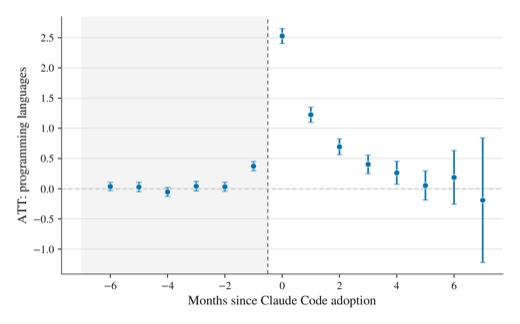

This file lives in `_drafts/`, so GitHub Pages never publishes it. To publish a real post,
copy it to `_posts/` with a dated name like `_posts/2026-11-15-my-first-post.md`,
change the title, write, and push to the `ss` branch.

The first paragraph becomes the excerpt on the blog index unless you set `description`
in the front matter.

## Math

Write math between double dollar signs. Inside a sentence it renders inline,
e.g. $$\hat{\tau} = \frac{1}{n}\sum_i (Y_i(1) - Y_i(0))$$; on its own lines it renders as a display equation:

$$
\mathrm{ATT}(g, t) = \mathbb{E}\left[ Y_t(g) - Y_t(\infty) \mid G = g \right]
$$

## Code

```python
import numpy as np
import pandas as pd

df = pd.DataFrame({"y": np.random.randn(100), "d": np.random.binomial(1, 0.5, 100)})
print(df.groupby("d")["y"].mean().diff().iloc[-1])
```

## Figures

Put images in `img/blog/` and reference them like this:

<figure>
  
  <figcaption>Figure 1: Languages used per month around Claude Code adoption.</figcaption>
</figure>

## Turning comments off

Comments appear at the bottom of every post through giscus (GitHub Discussions).
Add `comments: false` to the front matter to turn them off for one post.
