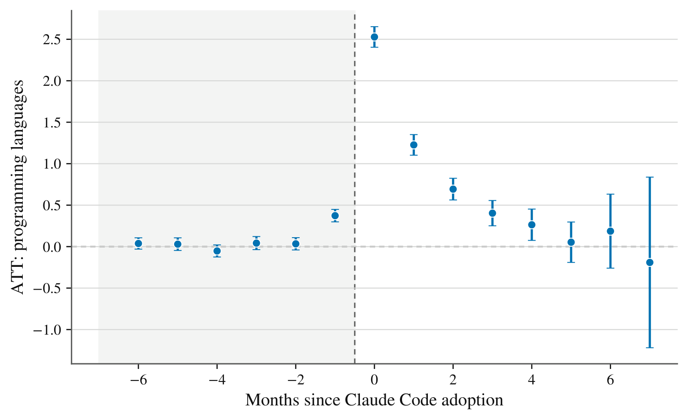

A skilled Python developer rarely writes production Rust. A data scientist who works in R and SQL rarely ships an iOS app in Swift. The languages a person codes in are set during training and early career, and they tend to stay put even when problem-solving ability would carry over. Kevin Xu and I wanted to know whether that changes when a developer starts working with a coding agent.

It helps to separate two generations of AI coding tools. The first, like GitHub Copilot and ChatGPT, proposes text that the developer still has to read, adapt, and run; that help is most useful in a language you already know. The second operates the computer. Claude Code can edit files across a repository, run commands and tests, read the errors, and iterate, while the developer specifies the task and checks the result. In the paper we call this *delegation*.

## What we measured

Claude Code adds a machine-readable line, `Co-Authored-By: Claude`, to the commits it produces, and that line is visible in public GitHub data. We collected 7,786,771 such commits from 185,517 distinct authors between January 2025 and January 2026, and dated each developer's adoption by their first Claude-co-authored commit: the first *detectable* use, not necessarily the first time they tried the tool.

GitHub does not attach a language to a commit, so we rebuilt each sampled developer's public history at the commit level: about 3.2 million commits touching 57 million changed files, each file assigned a language with GitHub's own Linguist rules, keeping only programming languages.

The analysis sample has 5,346 developers observed monthly from January 2024 to April 2026. Early adopters made their first Claude commit between April and September 2025; later adopters, who started between October 2025 and January 2026, serve as the comparison group in the months before their own adoption. We required at least five Claude-co-authored commits, so the results describe sustained adopters, and we removed automation accounts and developers with detectable use of other coding agents before adoption.

The design is an *event study*: instead of lining developers up by calendar date, we line them up by the month they first used the tool and track their outcomes before and after, relative to developers who adopt later but have not yet. We use the Callaway and Sant'Anna estimator, which is built for adoption that happens at different times.

## The main result

<figure>
  
  <figcaption>Figure 2 of the paper: estimated change in the number of programming languages a developer works in per month, by months since first detectable Claude Code use, relative to developers who had not yet adopted. Bars are confidence intervals; shading marks the pre-adoption period.</figcaption>
</figure>

Relative to the comparison group, the number of distinct programming languages a developer works in rises by 2.5 in the adoption month, against a pre-adoption average of 0.9: the active language set roughly triples. (The baseline is low because months with no public commits count as zero.) The effect is still 1.23 one month later and 0.69 two months later, then decays toward zero by the second half of the first year, with wider intervals at long horizons, where fewer adoption cohorts contribute.

The months before adoption are flat: the estimates from six to two months before are tightly estimated zeros. The small bump one month before fits the fact that a public commit can lag first use, though it is also consistent with activity ramping up as a new project starts.

The most direct test of the model is the count of *newly used* languages, ones that appear nowhere in the developer's observed history. Developers begin 1.19 such languages in the adoption month, nearly four times the pre-adoption monthly flow of 0.31. The cumulative count of languages ever used keeps growing after adoption, but because adopters were already accumulating languages somewhat faster beforehand, we treat that pattern as descriptive.

## Why delegation moves the frontier

Each month a developer faces opportunities in each language, and taking one pays only if its value clears the cost of producing the work. For an unfamiliar language, conversational help barely moves that bar, because its value scales with skill the developer does not have. Delegation lowers the bar: the agent executes part of the language-specific work, and the developer needs the general ability to specify, decompose, and verify. Opportunities too weak for solo or conversational work, but strong enough with an agent, form what we call an *activation band*. Newly used languages are its footprint in the data.

The frontier that moves is a production frontier, not a skill frontier. We do not claim that a Python developer learns to write Rust unassisted; the claim is that they can deliver a Rust project by directing and verifying an agent. In the model, delegation is worth nothing to someone who cannot specify and check the result.

The model also says who should gain most. Expected expansion is the number of unfamiliar languages a developer could move into, times the chance that each one gets activated, so narrow specialists have the most headroom. Since a developer with five commits looks narrow simply because we barely see them, we split developers at the median of pre-adoption activity, then by language breadth within each half. At both activity levels, specialists begin two to three times as many new languages at adoption as generalists: 0.98 versus 0.30 among the more active, and 2.39 versus 1.02 among the less active. A uniform burst of activity would not produce that pattern. The model also predicts larger gains for more able developers, but our ability proxy, past commit volume, cannot cleanly test that part.

## What we can and cannot say

The first worry is mechanical: adoption is dated by a commit, and commits carry languages. If we delete, in every month, all activity in the languages of each developer's first Claude commit, the language count still rises by 1.58 at adoption. If we rebuild every outcome from commits without the Claude trailer, so the agent's co-authored output is not counted, it still rises by 1.66, about two-thirds of the main effect (an approximation, since trailers can be stripped). Conditioning on pre-adoption activity leaves the estimate unchanged, and fake adoption dates placed twelve months early find nothing.

What these checks cannot rule out is selection in timing. Adoption is voluntary. A developer who decides to build something in an unfamiliar language may install Claude Code *because* the language is unfamiliar, and then the first Claude commit and the first commit in the new language arrive together. The largest effect falling in the adoption month fits this story. Some features are harder to explain with a one-time project shock, such as the language count staying elevated for months, including in unassisted commits, but the bulk of the adoption-month effect remains open to this alternative. So we read the estimates as event-time associations around first detectable use, not as definitive causal effects.

Two more limits: we see only public GitHub activity, so "unfamiliar" means not observed in a developer's public contributions since January 2024; and detection of other coding agents is a lower bound, since autocomplete leaves no trace in commits.

## What's next

The priority is an exogenous source of variation in adoption, such as regional rollouts of free-tier eligibility or pricing changes, which would support sharper causal designs. We also want better measures of ability, to study the order in which developers try new languages (adjacent ones first?), and to separate delegation from learning: whether the agent remains the executor or the developer eventually internalizes the language.

If the effects are causal, coding agents move the boundary of a developer's toolkit, not only their speed inside it: language-specific skill would matter less, and the ability to specify and verify work would matter more.

We presented this work at the Open and User Innovation Conference 2026 (Harvard Business School) and Empirical Methods in the Age of AI (Stanford HAI). The full paper, with the model and all robustness checks, is on arXiv: [arXiv:2605.25438](https://arxiv.org/abs/2605.25438). Comments, questions, and pushback are welcome below.
